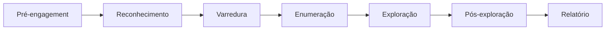

# Documentação — índice

Fluxo sugerido para um pentest web/rede de escopo restrito:

## Engajamentos (casos reais / notas de campo)

- [PLL — api + Jenkins (branch `pll-pentes`)](engajamentos/pll-pentest/README.md)

## Metodologia

- [PTES — fases do pentest](metodologia/ptes.md)
- [OWASP Top 10 — referência rápida](metodologia/owasp-top10.md)
- [Checklist de escopo e regras de engajamento](metodologia/escopo-checklist.md)
- [Pentest black box — metodologia](metodologia/blackbox.md)

## Reconhecimento

- [Recon passivo vs ativo](reconhecimento/passive-active.md)
- [OSINT e superfície de ataque](reconhecimento/osint.md)

## Varredura e enumeração

- [Varredura de portas e serviços](varredura/port-scan-web.md)
- [Enumeração SMB / rede interna](varredura/enum-rede.md)

## Exploração

- [Aplicações web](exploracao/web.md)
- [Rede e serviços](exploracao/rede.md)
- [Credenciais e autenticação](exploracao/credenciais.md)

## Relatório

- [Template de achados e severidade](relatorio/template.md)

## Scripts relacionados

Cada guia referencia scripts em [`../scripts/`](../scripts/README.md) quando aplicável.